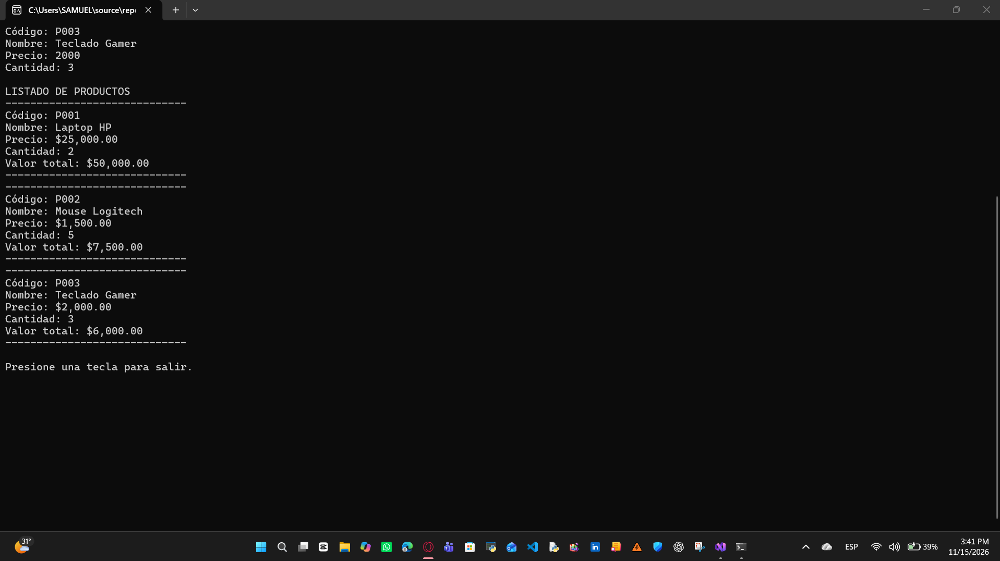
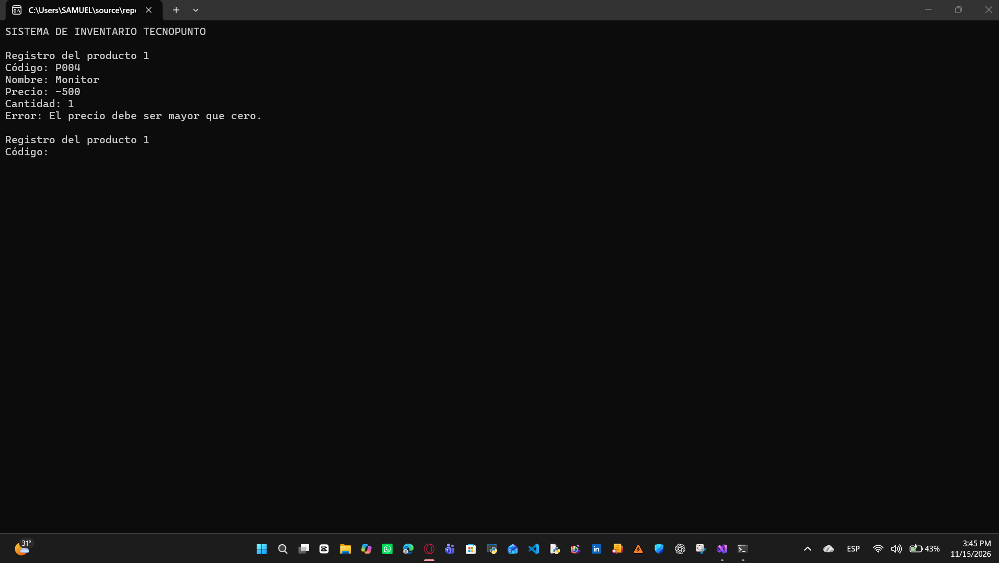
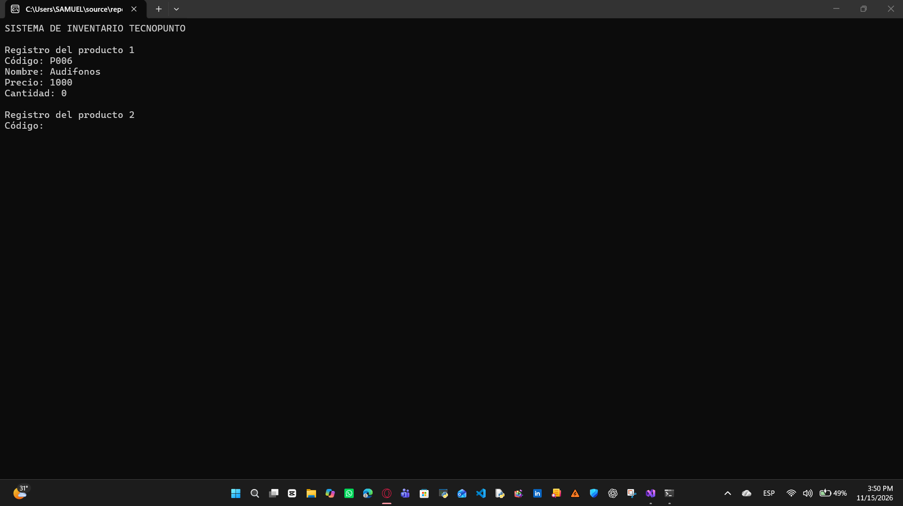

# Control de Inventario TecnoPunto

## Datos del autor
- Nombre: Samuel Trinidad Fernandez
- Matrícula: 20251639
- Asignatura: Programación Básica
- Profesor: Gamalier Reyes del Carmen

## Descripción del programa
Programa de consola desarrollado en C# para registrar productos y controlar el inventario de la tienda TecnoPunto.

## Datos de entrada
- Código del producto.
- Nombre del producto.
- Precio.
- Cantidad disponible.

## Datos que procesa
- Validación del nombre.
- Validación del precio.
- Validación de la cantidad.
- Cálculo del valor total.

## Datos de salida
- Código del producto.
- Nombre.
- Precio.
- Cantidad.
- Valor total del producto.

## Capturas de ejecución
Se incluyen evidencias de los siguientes escenarios:
1. Registro de productos válidos.
2. Precio negativo.
3. Nombre vacío.
4. Cantidad cero.
## Evidencias de ejecución

### 1. Productos válidos

### 2. Precio negativo

### 3. Nombre vacío

### 4. Cantidad cero

